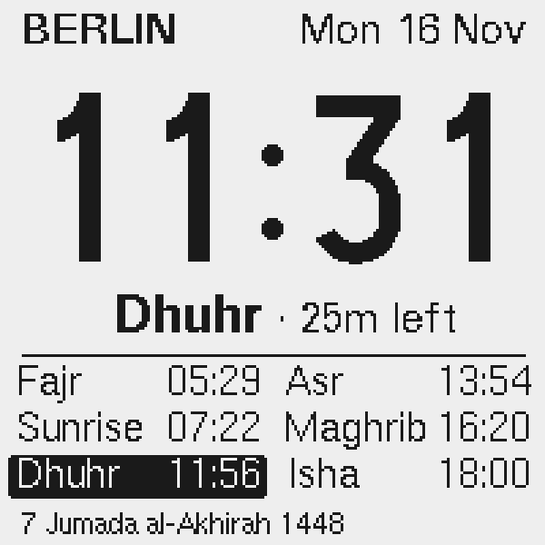
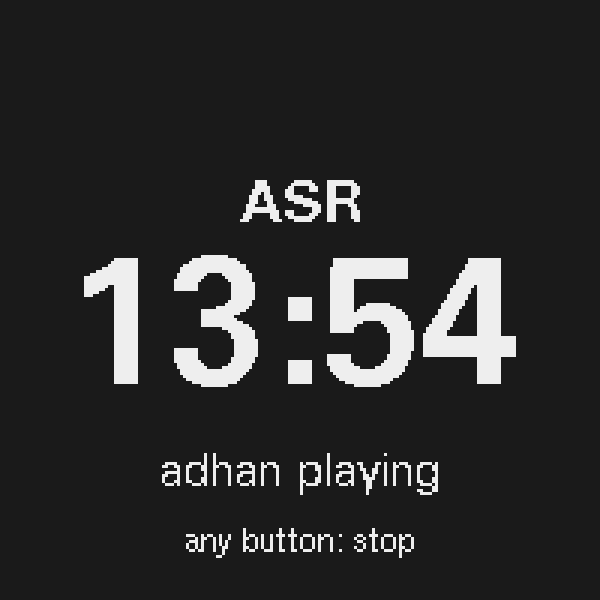
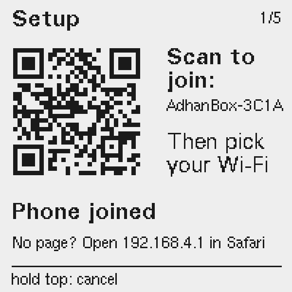

# AdhanBox

A small e-ink prayer clock that plays the adhan. It shows the next prayer and the time left until it, uses Diyanet prayer times for your city, keeps the right local time on its own, and plays a Turkish adhan at each prayer.

<p>
  
  
  
</p>

- **Next prayer at a glance.** A big countdown, refreshed every minute.
- **Diyanet times** for about 33 cities, one per timezone. They're cached for a month, so it keeps working when Wi-Fi is down.
- **Adhan at every prayer**, each in its own makam (Saba, Uşşak, Rast, Segâh, Hicaz). Turn it on or off per prayer, and set the volume.
- **Setup from your phone.** Scan the QR code on the screen, pick your Wi-Fi and city. No app.
- **Correct clock, no fiddling.** Time comes from the internet and follows your city's daylight saving rules. A backup clock chip keeps time when offline.

## What you need

| Part | Notes |
|---|---|
| [Waveshare ESP32-S3-ePaper-1.54](https://www.waveshare.com/esp32-s3-epaper-1.54.htm) **V2** | The V2 board has 8 MB flash. V1 (4 MB) is not supported. |
| A small speaker | Any 4–8 Ω, 1–3 W speaker with an MX1.25 2-pin plug. Not included with the board. |
| USB-C data cable | Some cables only charge. If the board isn't found, try another one. |
| 2.4 GHz Wi-Fi | The ESP32-S3 can't use 5 GHz networks. |

## Install

Plug the board into your computer, then use either option. Both download the latest release, find the board and flash the firmware and adhan audio. Neither needs Rust or any developer tools.

### Option 1: from the browser (macOS, Windows, Linux)

Open **[azer.github.io/adhanbox](https://azer.github.io/adhanbox/)** in Chrome or Edge and click **Install AdhanBox**.

### Option 2: from the terminal (macOS, Linux)

```sh
curl -fsSL https://raw.githubusercontent.com/azer/adhanbox/main/install.sh | sh
```

The script downloads a prebuilt copy of [`espflash`](https://github.com/esp-rs/espflash) into a temporary folder, waits for the board to show up on USB, checks that it's an ESP32-S3 with 8 MB flash, writes the firmware and cleans up after itself. Nothing is installed system-wide.

Options go after `sh -s --`:

```sh
curl -fsSL https://raw.githubusercontent.com/azer/adhanbox/main/install.sh | sh -s -- --no-audio
```

| Option | What it does |
|---|---|
| `--port /dev/cu.usbmodem101` | Use this port instead of detecting it |
| `--version v0.1.0` | Install a specific release |
| `--no-audio` | Skip the 4 MB adhan audio. Use it for quicker firmware updates once the audio is on the board. |
| `--erase` | Wipe the whole flash first, settings included |

Updating works the same way: run the command again. Your Wi-Fi, city and volume settings are kept.

On Linux, if you see a permission error, add yourself to the `dialout` group (`sudo usermod -aG dialout $USER`) and log in again.

## First-time setup

1. After flashing, the board restarts and shows **AdhanBox**. Press any button.
2. A QR code appears. Scan it with your phone camera to join the `AdhanBox-XXXX` network. The setup page opens on its own. If it doesn't, open `192.168.4.1`.
3. Pick your Wi-Fi network, type the password and choose your city.
4. The board fetches the prayer times and plays a short adhan clip so you can set the volume.

That's it. From then on it syncs on its own.

## Using it

There are two buttons on the side: **top** (BOOT) and **bottom** (PWR).

| Where | Top press | Bottom press | Hold top |
|---|---|---|---|
| Home | menu | menu | — |
| Lists | up | down | select |
| Volume | louder | quieter | done |
| Adhan playing | stop | stop | stop |

The menu has **City**, **Adhan** (on/off per prayer), **Volume**, **Wi-Fi** and **Reset**.

**Stuck?** Hold the top button for 10 seconds on any screen to reach the reset screen. It still asks before erasing anything. If the screen stays blank after plugging in, unplug and plug back in without holding any button (holding BOOT while plugging in puts the chip into flashing mode). As a last resort, re-run the installer with `--erase`.

## How it works

The firmware is written in Rust on top of ESP-IDF. It gets UTC from SNTP, converts it with your city's POSIX timezone rule, fetches a month of Diyanet prayer times over HTTPS and stores them in flash. At each prayer it decodes the adhan MP3 from a dedicated flash partition and plays it through the board's ES8311 audio codec. The screen uses fast partial refreshes each minute and a full refresh every hour to avoid ghosting.

The full design (hardware map, screens, flows, audio pipeline) is in [SPEC.md](SPEC.md).

## Development

You only need this section to change the code.

| Path | What |
|---|---|
| `core/` | Shared logic and UI: scheduling, Diyanet parser, cities, screens (tested on the host) |
| `firmware/` | ESP32-S3 binary (Rust std on ESP-IDF 5.4, `esp` toolchain) |
| `simulator/` | Renders every screen to `target/screens/*.png` |
| `xtask/` | Host tools: cities, audio pack, flash, release, setup, reset, log |
| `web/` | Browser installer, published to GitHub Pages on each release |
| `install.sh` | Terminal installer |
| `cities.toml` | City list (order = on-device order) |
| `assets/ezan/` | Adhan MP3s: `sabah`, `ogle`, `ikindi`, `aksam`, `yatsi` (not in git) |

### Toolchain

```sh
cargo install espup espflash ldproxy
espup install --targets esp32s3 --std
brew install ninja ffmpeg
mkdir -p firmware/.tools/bin && ln -sf "$(which python3.12)" firmware/.tools/bin/python3
```

ESP-IDF needs Python 3.13 or older; the symlink pins 3.12. The first firmware build downloads ESP-IDF into `firmware/.embuild` (about 1.5 GB). Use rustup's `cargo` (`~/.cargo/bin` first in `PATH`), not Homebrew's.

### Commands

```sh
cargo test -p ezanbox-core --features std   # logic tests
cargo run -p simulator                       # render screens → target/screens/
cargo xtask flash                            # build + flash app + adhan pack + monitor
cargo xtask flash --no-monitor
cargo xtask flash-audio                      # re-pack and flash only the adhan files
cargo xtask log --secs 30                    # print device output
cargo xtask status                           # city, clock, cached days, next prayer
cargo xtask setup --ssid "Net" --pass "pw" --city berlin   # Wi-Fi + city over USB
cargo xtask sync                             # fetch times now
cargo xtask reset [--all]                    # clear settings (--all: also erase audio)
cargo xtask cities                           # regenerate core/src/cities_gen.rs
cargo xtask release                          # build the release files into dist/
```

### Making a release

```sh
cargo xtask release
gh release create v0.1.0 dist/* --title v0.1.0 --notes "..."
```

`cargo xtask release` writes `bootloader.bin`, `partition-table.bin`, `adhanbox.bin`, `audio.bin` and `flash.txt` (the flash address of each file) to `dist/`. The installer script reads `flash.txt` from the latest release, and publishing a release redeploys the browser installer with the same files.

The parts are flashed separately rather than as one merged image, so updates don't overwrite the settings partition.

## License

Code: [MIT](LICENSE).
